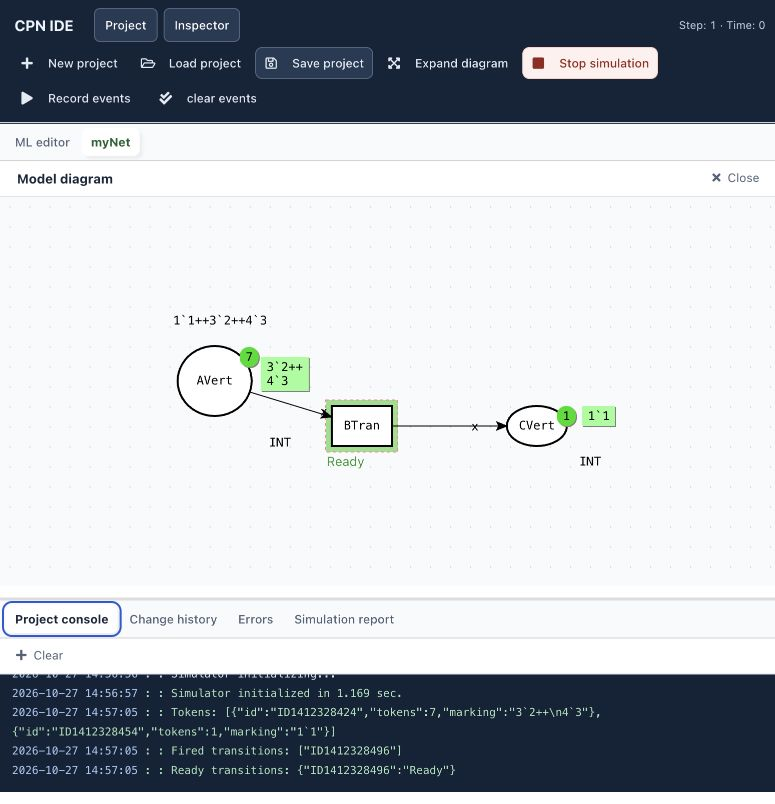

# CPN IDE in Docker

An unofficial Docker distribution of [CPN IDE](https://cpnide.org/) with a browser interface, responsive workspace panels, a browser saving fix, and modest runtime tuning. No Windows installation is required.

Based on [cpn-io/cpn-js](https://github.com/cpn-io/cpn-js), version **1.24.1031**, upstream commit [`38b72b8f067bb454ab2bf873cb0d9bca1f1f9a1b`](https://github.com/cpn-io/cpn-js/commit/38b72b8f067bb454ab2bf873cb0d9bca1f1f9a1b). Upstream history and copyright notices are retained. This fork is not an official upstream release or an endorsement by its authors.



## Requirements

- Docker Engine with Docker Compose v2; Docker Desktop is the tested option on Apple Silicon macOS.
- Git, a browser, and network access during the first build. Python 3 is needed only for the optional runtime test.
- Enough Docker memory for the legacy Angular/Gradle build; 4 GiB is a practical starting allocation, not a measured minimum. The running container is limited to 1 GiB and 2 CPUs by default.
- Support for running **32-bit x86 Linux executables**. The frontend and Java runtime use the host's supported image architecture, but the bundled Linux SML simulator is i386. Docker Desktop provided the required emulation in the tested setup. ARM Linux installations without i386 emulation are not covered by these instructions.

The project uses legacy Node 14 / Angular 9 and Java 8 / Spring Boot 2.1 dependencies for compatibility. This is intended as a local research/teaching tool. It has no added authentication and is not prepared for public Internet deployment.

## Quick start

```sh
git clone https://github.com/Gartoom/cpn-js.git
cd cpn-js
./scripts/build.sh
docker compose up -d
```

Open **[http://127.0.0.1:18736/](http://127.0.0.1:18736/)** after the server starts. The build helper embeds the current Git revision in the app's **Source / license** page. Commit your changes before building a version you intend to share, so that link identifies the actual source.

For a different port:

```sh
export CPNIDE_PORT=18740
./scripts/build.sh
docker compose up -d
```

Use the same environment variable for subsequent Compose commands. If another installation already uses port 18736, stop it or choose a different port.

On macOS, after the initial build, double-click **`scripts/launch.command`** in Finder. It starts Docker Desktop, starts the Compose service, waits for the server and opens the browser. Linux users can run the same script with Docker already available; it uses `xdg-open` when installed. No additional global launcher or application is installed by this repository.

## Use the simulator

1. Choose **Load project** to open a `.cpn` file from your computer.
2. In **Project**, double-click a page such as `myNet` to open its diagram.
3. Choose **Validate**, then **Start simulation**.
4. Click an enabled transition highlighted in green. The step and time appear in the top bar.
5. Choose **Stop simulation** to return to editing.
6. Choose **Save project**, enter a filename, and confirm **Save**. The browser downloads the `.cpn` file; check your Downloads folder or browser download settings.

On narrow windows, **Project** and **Inspector** open side drawers; Escape closes them. Tabs support Left/Right, Home/End, Enter and Space. Diagram editing itself has not received a complete keyboard or screen-reader accessibility overhaul.

Save model files explicitly. Closing the tab is not a save operation and does not stop the container. Upstream saving also stops simulation; a `.cpn` model download should not be treated as a complete checkpoint of a running simulation.

## Stop, restart, update and back up

```sh
docker compose stop       # release container memory
docker compose start      # start the existing container
docker compose logs --tail 60
```

To update this fork, save your model, run `git pull --ff-only`, `./scripts/build.sh`, then `docker compose up -d`.

The simulator's `/data` working directory is a **256 MiB tmpfs**. This avoids `EOVERFLOW` from the old simulator's 32-bit directory access on Docker Desktop. It is temporary and is not a model backup.

Generated reports under `/data/CPN_IDE` are archived every 15 seconds and on graceful shutdown into `/store/reports.tar`, on a named Compose volume. Startup restores that archive. A crash may lose the latest changes; save your `.cpn` files separately on the host. Keep the checkout directory / Compose project name stable to reuse the same named volume.

Back up the report archive after stopping the service:

```sh
docker compose stop
docker compose cp cpnide:/store/reports.tar ./reports-backup.tar
```

The command requires an existing report archive. For a fresh installation there may be no archive yet. To restore, stop the service, copy the archive back with `docker compose cp ./reports-backup.tar cpnide:/store/reports.tar`, then start it. Protect backup files if models or reports contain private data.

`docker compose down` removes the containers and network but retains the named report volume. **Do not add `--volumes` unless you intend to delete stored reports.** To roll back application code, save your model, check out a known-good commit, rebuild and run `docker compose up -d`. A saved Git revision does not itself back up model or report data.

## What changed

| Feature | Implementation |
|---|---|
| Docker packaging | Multi-stage build: Node builds Angular; Java 8 builds the Spring Boot JAR; a JRE runs it with 32-bit libc for the simulator. Non-root UID 1000, localhost-only port, init process and graceful shutdown. |
| Browser/server connection | Default API addresses use `window.location.origin`, replacing fixed development addresses. Angular ViewEngine is retained for this old codebase. |
| Browser saving | TypeScript checks that Electron's `fs.writeFile` exists before using it; browser sessions fall back to the existing filename/download flow. |
| Workspace appearance | Dark toolbar, clearer controls and tabs, dotted canvas background, readable console, focus styling, responsive Project/Inspector drawers, persistent step/time indicator. Model geometry and object colors are not overridden. |
| Keyboard support | Named toolbar actions, Enter/Space activation, tab roles and arrow navigation, drawer Escape handling. |
| Runtime tuning | Java starts with a 32 MiB heap, retains a 512 MiB maximum, uses Serial GC with adjusted free-heap ratios; large HTTP responses use gzip. |
| UI work reduction | Presentation decoration ignores changes inside SVG diagrams, console output, the code editor and its own status output. |
| Source availability | Visible Source / license link, full AGPL text served with the app, and a build-time revision link to this repository. |
| Launch and checks | Compose configuration, a macOS/Linux launcher, source checks, API validation/transition test and optional GitHub Actions workflow. |

See [CHANGELOG.md](CHANGELOG.md) for the feature history, [architecture](docs/ARCHITECTURE.md) for implementation details, and [verification and limits](docs/VERIFICATION.md) for the measured scope.

This repository contains the modern **CPN IDE** distribution. The separate old **CPN Tools 2.3.5/noVNC** installation is not part of these changes.

## Performance: measured scope

On a small example, two runs of the previous local UI version used **240.2–252.1 MiB** after eight transitions; two runs of the final local tuning used **233.4–235.9 MiB**, about **4.7% less on average**. This excludes Docker Desktop and browser memory. Startup (~2.5 s), validation (~4.9 s) and simulator initialization (~1.2 s) were effectively unchanged in this small sample.

The previous main JavaScript payload went from **1,777,954 to 413,868 bytes** with gzip, about **77% less transferred**. This is a transfer-size result, not a promise of faster local loading. The source rebuild may produce different bundle hashes and sizes. No substantial simulation-speed improvement is claimed; the old simulator still uses emulation on Apple Silicon.

These measurements describe the earlier installed build and the same tuning, not a broad benchmark of all models. [Raw measurements](docs/benchmark.json) and [test details](docs/VERIFICATION.md) are included. The earlier experiment also specified Tomcat thread settings; the application actually uses **Jetty**, so those inactive settings are omitted here and no thread-pool reduction is claimed.

## Verify your build

```sh
python3 scripts/verify-runtime.py
```

This initializes the bundled Dining Philosophers model in a separate API session, validates it and verifies one transition advances the simulation step. Stop/recreate the test container afterwards if you want to discard that session. The optional workflow builds and tests on Linux amd64; it does not prove Apple Silicon UI compatibility. Workflows on new forks may need to be enabled in GitHub's Actions tab.

## Copyright, license and redistribution

**CPN IDE is copyrighted software, released by upstream under GNU AGPL version 3.** This fork preserves the full [LICENSE](LICENSE), original authorship and notices. The changes here are also offered under AGPL-3.0. Original components remain under their own applicable licenses; this repository does not claim ownership of upstream code, names or logos.

You may use and modify the covered program, including commercially. Private local modifications do not require public publication. If you distribute copies or give others network access to a modified version, applicable AGPL obligations include preserving notices, marking changes, retaining the license, and providing the appropriate corresponding source and build/install information. For remote users of a modified service, AGPL section 13 requires a prominent opportunity to obtain the corresponding source at no charge. The app includes a source link for that purpose.

These are a summary, not a replacement for the full license. [Licensing details and third-party notices](docs/LICENSING.md) cover redistribution, source offers, patents, trademarks, warranty, termination and known component-license gaps. **No warranty or upstream endorsement is provided.** Your independently authored model files and simulation outputs do not automatically become AGPL solely because you use this tool; copied program material may have its own conditions.

This repository publishes source changes and build instructions, **not prebuilt images or new binary releases**. Several binaries already present in upstream have incomplete bundled license/source metadata, including the native simulator and some JARs. The license document identifies those gaps rather than claiming that the AGPL file clears every third-party binary for redistribution. Before distributing an image, resolve those component obligations and supply the required notices and source for that exact image.
